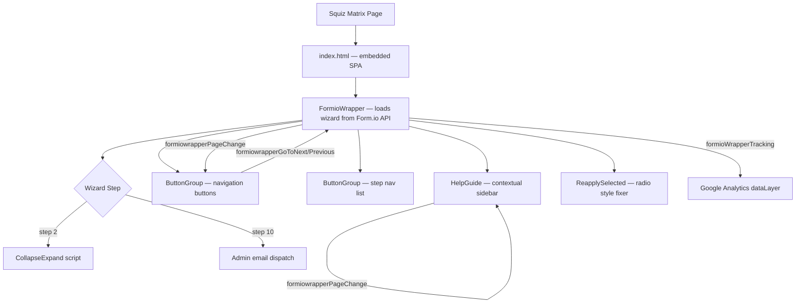

## Overview

Label Buster is a single-page application embedded in a Squiz Matrix CMS page. It guides Queensland food businesses through the Australia New Zealand Food Standards Code labelling requirements via a multi-step Form.io wizard.

## Technology Stack

| Layer | Technology | Version |
|---|---|---|
| Form rendering | Form.io SDK | external CDN |
| UI components | lit-html | ^1.3.0 |
| Bundler | Parcel | ^1.12.4 |
| Styles | SCSS | via sass ^1.32.8 |
| Testing | Karma + @open-wc/testing | ^6.1.1 |
| Linting | ESLint (airbnb-base) + Prettier | ^7.21.0 / 2.2.1 |
| CMS host | Squiz Matrix | external |

## Application Flow



## Module Boundaries

| Module | Location | Responsibility |
|---|---|---|
| `FormioWrapper` | `src/components/formio-wrapper.js` | Loads Form.io wizard, page change events, PDF, email |
| `ButtonGroup` | `src/components/button-group.js` | Renders nav buttons and step-nav list via lit-html |
| `HelpGuide` | `src/components/help-guide.js` | Contextual sidebar with accordion sections |
| Validation scripts | `src/validations/**/*.js` | Per-field Form.io custom validation logic |
| `Environment` | `src/environment.js` | Detects dev/uat/prod from URL; provides API endpoints |
| `configuration` | `src/config.js` | Static application defaults |
| Scripts | `src/scripts/` | Collapse-expand, print, step-handlers, reapply-selected |
| Partials | `src/components/partials/` | lit-html templates for HelpGuide views |
| Resources | `src/resources/` | Per-section HTML pages built separately by Parcel |

## Integration Points

- **Form.io API** (`api.forms.platforms.qld.gov.au`): provides wizard JSON schema, handles form submission and PDF generation.
- **Squiz Matrix CMS**: hosts the page shell (`#qg-primary-content`, `#qg-section-nav`). Label Buster manipulates these DOM nodes on `DOMContentLoaded`.
- **Google Analytics**: receives `formio-interaction` events via `window.dataLayer`.
- **Email**: admin confirmation email dispatched on wizard step 10 via Form.io backend.

## Build Targets

Two Parcel build targets:
1. `src/index.html` — main SPA bundle (FormioWrapper + ButtonGroup + HelpGuide).
2. `src/resources/**/*.html` — standalone resource/guide pages, built separately.

## Environment Detection

`Environment` class (see `environment-config.md`) reads `window.location.href` at construction time:
- `localhost` or `dev` in URL → `development` (dev API endpoint)
- `uat` in URL → `uat`
- all other → `production`

## Getting Started

Prerequisites: Node.js ≥ 14, npm.

```
npm install
npm start        # dev server via parcel
npm test         # karma test suite
npm run lint     # eslint + prettier
npm run build    # production build to dist/
```

## Design Decisions

- **Form.io for form rendering**: offloads schema management and submissions to an external service; avoids hand-writing complex conditional form logic.
- **lit-html for UI components**: minimal runtime overhead versus a full framework; suitable for isolated web components that react to custom events.
- **Custom events as inter-component bus**: `formiowrapperPageChange`, `formiowrapperGoToNext/Previous`, `formioNewPageRender`, and `formioWrapperTracking` decouple FormioWrapper from ButtonGroup and HelpGuide without introducing a shared state library.
- **Parcel v1**: chosen for zero-config bundling of SCSS + ES modules; v1 used for IE11 transpilation support required by `browserslist`.
