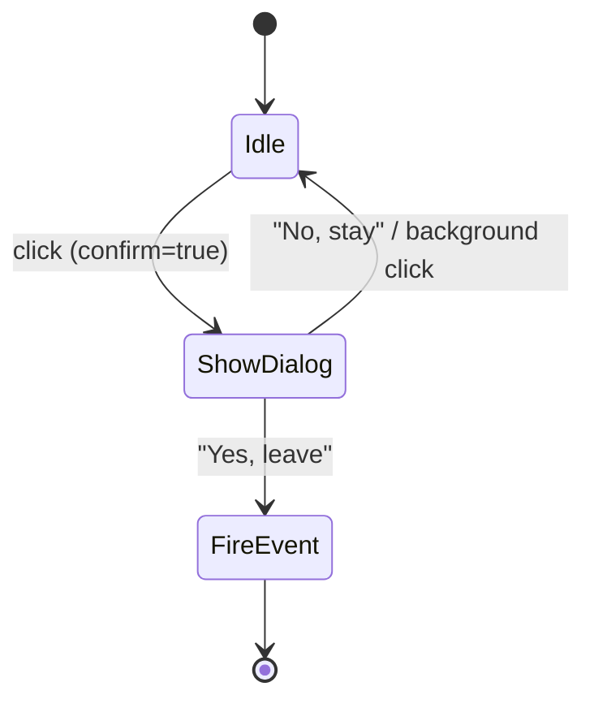

## Overview

`ButtonGroup` renders navigation controls and the wizard step-nav list using lit-html. It consumes `formiowrapperPageChange` events and renders buttons that fire custom events back to `FormioWrapper`. Used twice in the app: once for the primary action buttons (next / previous / cancel), once for the ordered step navigation list.

## Constructor

| Parameter | Type | Description |
|---|---|---|
| `target` | `HTMLElement` | DOM node to render buttons into |
| `data` | `string` | Key in the `formiowrapperPageChange` detail to read (`'buttons'` or `'navigation'`) |

On construction, registers `formiowrapperPageChange` listener that calls `updateTarget(detail)`.

## Public Methods

| Method | Signature | Description |
|---|---|---|
| `updateTarget` | `(data: Array) → void` | Renders updated buttons into `this.target` |
| `generateButton` | `(text, event, cssClass, disabled, displayed, active, detail, type, confirm) → TemplateResult` | Returns lit-html for one button or `<li>` |
| `processClick` | `(event) → void` | Intercepts click; shows confirmation dialog if `data-confirm !== 'false'`, else fires event |
| `fireEvent` | `(event) → void` | Dispatches CustomEvent named by `data-event` with `data-detail` as payload |
| `toggleDialog` | `() → void` | Toggles cancel-confirmation dialog visibility |
| `confirmCancel` | `() → void` | Closes dialog and fires the buffered cancel event |

## Button Data Shape

Each item in the buttons/navigation array from `formiowrapperPageChange`:

| Field | Type | Description |
|---|---|---|
| `title` | `string` | Button label text |
| `event` | `string` | CustomEvent name to fire on click |
| `cssClass` | `string` | CSS classes |
| `disabled` | `boolean` | Disables interaction |
| `displayed` | `boolean` | Hides element if false |
| `active` | `boolean` | Adds `active` class (step nav only) |
| `detail` | `Object` | Payload passed as CustomEvent detail |
| `type` | `string` | `'button'` (default) or `'li'` for step nav |
| `confirm` | `boolean` | Shows cancel confirmation before firing event |

## Step Navigation Behaviour

When `type === 'li'`, `ButtonGroup` wraps each button in an `<li>`. For the step navigation mode, `updateParentIfFirstStepSkipped` patches the parent `<a class="active">` in `#qg-section-nav` to behave as a clickable nav step, bypassing step 0 per `configuration.navigation.skipFirstNavStep`.

## Cancel Confirmation Dialog

Rendered via `_createConfirmation()` into the lit-html output when no `<li>` buttons are present (i.e., primary action button mode). Dialog text and button styles come from `configuration.confirmation`.

## Design Decisions

- **lit-html for rendering**: enables efficient in-place DOM updates on every `formiowrapperPageChange` without a virtual DOM diffing library.
- **`data-event` / `data-detail` attributes**: decouples button identity from handler binding; any element can fire events using the same `processClick` handler regardless of how it was rendered.
