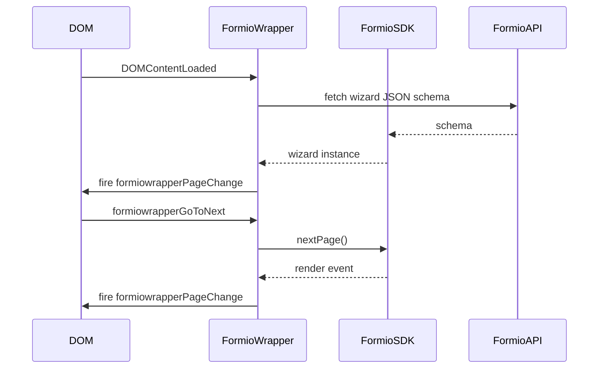

## Overview

`FormioWrapper` is the central component of the Label Buster SPA. It loads a Form.io multi-step wizard from the API, manages page transitions, fires custom DOM events consumed by sibling components, handles PDF downloads, and dispatches admin email on final submission.

## Constructor

| Parameter | Type | Description |
|---|---|---|
| `configuration` | `Object` | Merged config from `src/config.js` + `Environment` overrides |

On construction: stores config, calls `_addListeners(config.form.baseElement)`.

## Public Methods

| Method | Signature | Description |
|---|---|---|
| `initialise` | `(firstInit = true) → void` | Loads Form.io wizard from `config.form.location`; on first init also attaches wizard event handlers and creates PDF instance |

## Custom Events Fired

| Event | Trigger | Payload (`detail`) |
|---|---|---|
| `formiowrapperPageChange` | Page render, change, initialized | `{ page, buttons[], navigation[] }` |
| `formioWrapperTracking` | Form field change | `{ form, change }` |
| `formiowrapperSendAdminEmail` | Wizard reaches step 10 | none |

## Custom Events Consumed

| Event | Source | Action |
|---|---|---|
| `DOMContentLoaded` | window | Calls `initialise()` |
| `formiowrapperGoToNext` | ButtonGroup | Advances wizard one page, scrolls to top |
| `formiowrapperGoToPrevious` | ButtonGroup | Goes back one page, scrolls to top |
| `formiowrapperCancel` | ButtonGroup | Cancels form; clears localStorage if `clearStorageOnCancel` |
| `formiowrapperGoToPage` | ButtonGroup / HelpGuide | Jumps to specific page index |
| `formiowrapperSendAdminEmail` | self (step 10) | Sends email via Form.io PDF endpoint |
| `downloadPDF` | wizard | Downloads PDF from `pdfEndpoint` |

## Configuration Surface

Relevant keys from the `form` config block:

| Key | Type | Description |
|---|---|---|
| `location` | `string` | Full Form.io form URL (environment-specific) |
| `baseLocation` | `string` | Base API URL (environment-specific) |
| `pdfEndpoint` | `string` | Path suffix for PDF endpoint (`labelBusterPdf`) |
| `endpoint` | `string` | Submission path suffix (`submission`) |
| `adminEmail` | `string` | Recipient for admin confirmation (environment-specific) |
| `selector` | `string` | DOM selector for form mount point (`#formio`) |
| `downloadPDF` | `boolean` | Enables PDF download button |
| `clearStorageOnCancel` | `boolean` | Clears localStorage on cancel |

## Data Flow

## Design Decisions

- **PDF creation via separate Form.io submission**: the PDF endpoint is a Form.io action endpoint, not a client-side render; keeps PDF logic server-managed.
- **`firstInit` guard**: prevents double-binding of wizard event handlers when `initialise()` is called after a navigation reset (e.g. cancel + restart flow).
- **`wizard.page === 8` submission snapshot**: re-applies `_data` to submission to ensure accumulated form state is preserved when navigating back to that step.
