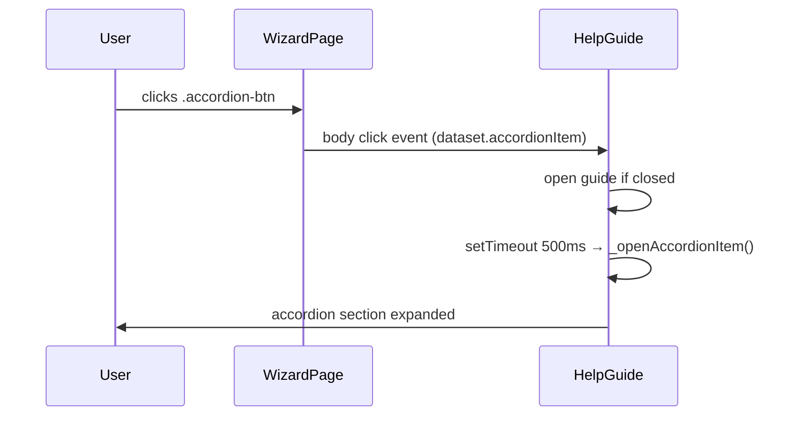

## Overview

`HelpGuide` renders a contextual sidebar alongside the Form.io wizard. It shows an onboarding view on first visit, then displays a step-specific lit-html partial on each wizard page where it is configured to appear. Users can open, close, and print the guide. An accordion within the main view allows expanding/collapsing food-category-specific regulatory information.

## Constructor

| Parameter | Type | Description |
|---|---|---|
| `target` | `HTMLElement` | DOM node the guide is rendered into (`#help-guide`) |
| `config.views` | `Object` | Map of step number (or `'initial'`) to lit-html partial functions |
| `config.displayOnSteps` | `Array<number>` | Steps where the guide should be visible |
| `config.formWrapper` | `FormioWrapper` | Reference to the FormioWrapper instance |
| `config.config` | `Object` | HelpGuide-specific config (`initialState`, `mobileSize`) |

## Initial State Logic

State is persisted in `localStorage` under the key `help-guide`.

| Condition | Resolved State |
|---|---|
| `localStorage` has `help-guide` key | `active` (open, not first view) |
| `config.initialState === 'minimized'` | closed, not first view |
| `config.initialState === 'onboarding'` (default) | open, showing onboarding |

## Lifecycle Events

| Event | Source | Action |
|---|---|---|
| `formiowrapperPageChange` | window | Calls `updateTemplate()` to redraw with current page data |
| `formioNewPageRender` | window | Calls `updateTemplate({ open: overwrite })` — applies mobile-state overwrite |
| `click` on `.accordion-btn` | document.body | Opens guide if closed, then opens the targeted accordion item |

## Views Map

Step-to-partial mapping from `src/index.js`:

| Step | Partial | Content |
|---|---|---|
| `'initial'` | `help-guide-lb-initial` | Onboarding: "Before you start" |
| `3` | `help-guide-lb-main` | General + food-category accordion (alcoholic drinks, GMO, novel foods, special purpose, etc.) |
| `4` | `help-guide-lb-names` | Food name and description guidance |
| `5` | `help-guide-lb-business` | Business details guidance |
| `6` | `help-guide-lb-date-mark` | Date marking guidance |
| `7` | `help-guide-lb-storage` | Storage and use instructions guidance |
| `8` | `help-guide-lb-ingredient` | Ingredients labelling guidance |
| `9` | `help-guide-lb-statement` | Advisory statements guidance |

## Accordion Interaction

The main view partial (`help-guide-lb-main.js`) renders a `qg-accordion` with one article per food category. Clicking an `.accordion-btn` in the wizard page fires a body click event. `HelpGuide` intercepts this, opens itself if minimised, and after a 500 ms animation delay, calls `_openAccordionItem(itemID, isOpen)` to expand the matching accordion article.

## Configuration Keys

| Key | Type | Default | Description |
|---|---|---|---|
| `initialState` | `string` | `'onboarding'` | Starting state: `'onboarding'`, `'active'`, or `'minimized'` |
| `overwriteMobileStateWith` | `false\|string` | `false` | If set, forces guide state on mobile (`< mobileSize`) at each page render |
| `mobileSize` | `number` | `991` | Breakpoint (px) below which `overwriteMobileStateWith` applies |

## Accessibility

- Accordion buttons use `aria-expanded` and `aria-controls` on the underlying checkbox inputs.
- Print action uses `printScreen()` which targets only `#help-guide` content.
- `returnTab` is set to the accordion button that triggered opening, intended for focus restoration after animation (partially implemented — not yet called on close).

## Design Decisions

- **`localStorage` persistence**: remembers whether the user has seen the onboarding view; avoids showing it again on subsequent visits.
- **500 ms animation delay for accordion open**: Matches CSS transition duration so the accordion content is visible after the open animation.
- **Views as a Map (step → partial)**: partials are only imported for steps that have content; guide renders nothing on steps outside `displayOnSteps`.
